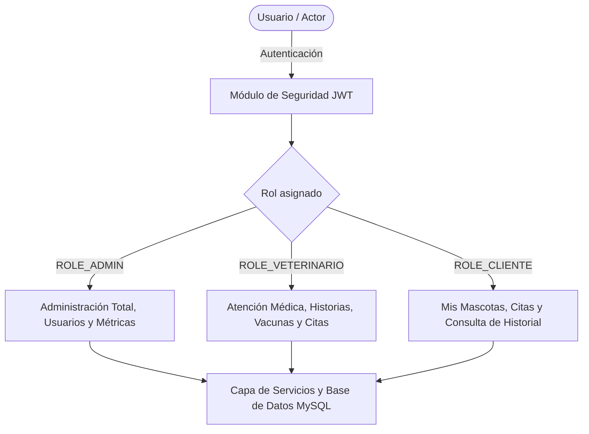
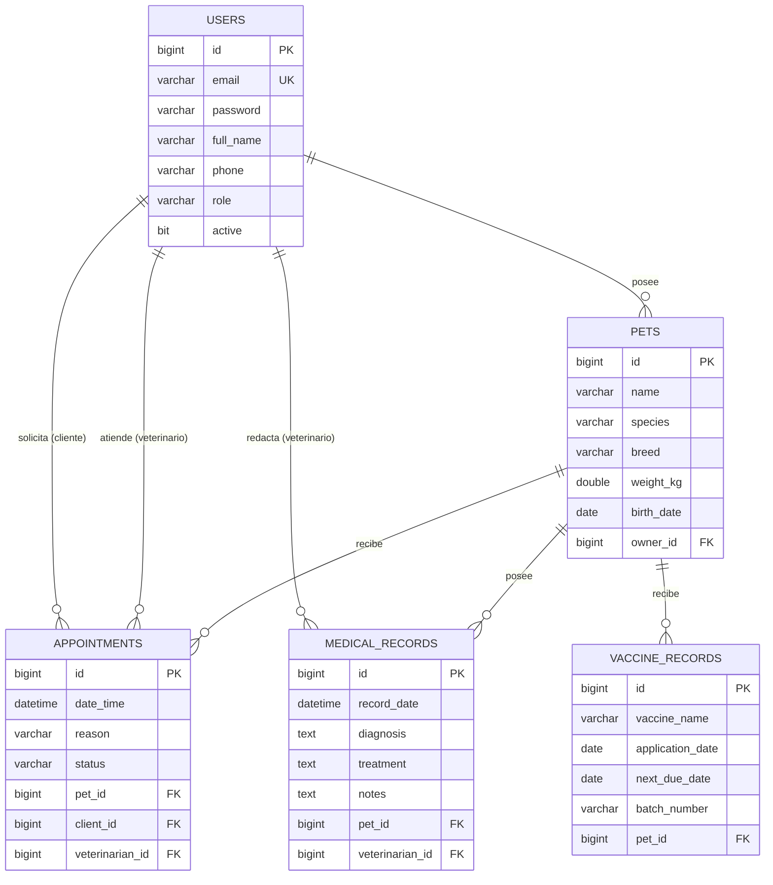
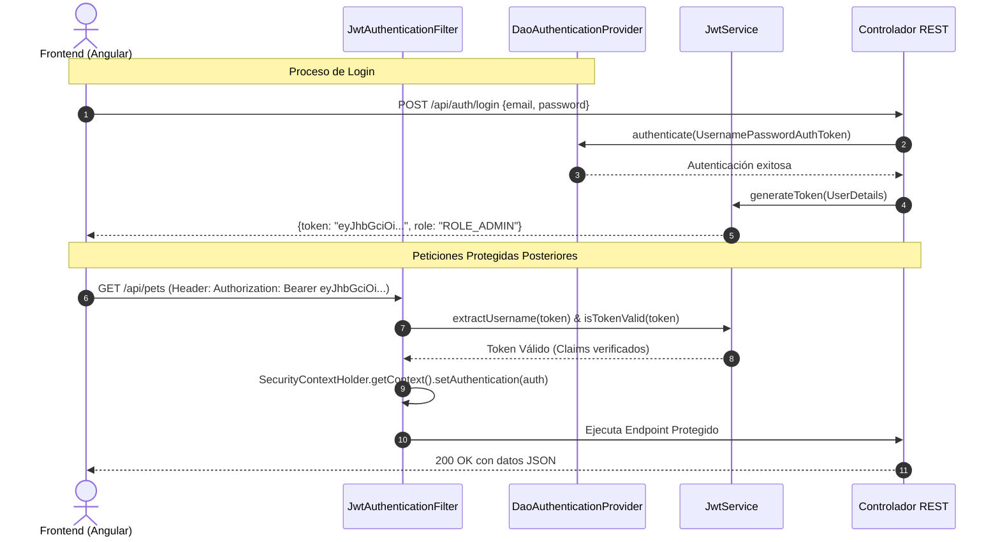

# INFORME TÉCNICO DE AVANCE DE PROYECTO
# SISTEMA DE GESTIÓN VETERINARIA — ZOOVET (VETCARE PRO)

---

## ÍNDICE
1. [Introducción](#1-introducción)
2. [Objetivos del avance](#2-objetivos-del-avance)
3. [Descripción del sistema](#3-descripción-del-sistema)
4. [Arquitectura del proyecto Spring Boot](#4-arquitectura-del-proyecto-spring-boot)
5. [Implementación de API REST y CRUD](#5-implementación-de-api-rest-y-crud)
6. [Dependency Injection y DTOs](#6-dependency-injection-y-dtos)
7. [Persistencia con JPA/Hibernate](#7-persistencia-con-jpahibernate)
8. [Consultas y operaciones con base de datos](#8-consultas-y-operaciones-con-base-de-datos)
9. [Seguridad inicial con Spring Security](#9-seguridad-inicial-con-spring-security)
10. [Evidencias del proyecto](#10-evidencias-del-proyecto)
11. [Dificultades encontradas](#11-dificultades-encontradas)
12. [Conclusiones](#12-conclusiones)
13. [Anexos](#13-anexos)

---

## 1. Introducción

El presente informe describe el desarrollo técnico, arquitectura e implementación del sistema informático **ZooVet** (también denominado **VetCare Pro**). Este sistema ha sido concebido para modernizar y optimizar la administración integral de centros veterinarios y clínicas de atención animal.

Tradicionalmente, numerosas veterinarias operan mediante procesos descentralizados o manuales: registros en papel, hojas de cálculo independientes y escasa trazabilidad en historias clínicas, esquemas de vacunación y agenda de citas. Esta desarticulación genera pérdida de información, errores en la continuidad de tratamientos médicos y demoras en la atención al cliente.

**ZooVet** responde a esta problemática implementando una solución web moderna basada en una arquitectura cliente-servidor desacoplada:
* Un **Backend robusto** desarrollado con **Spring Boot (Java 21)**, orientado a servicios RESTful, persistencia relacional con **MySQL** y seguridad sin estado basada en **JWT**.
* Un **Frontend interactivo** desarrollado en **Angular 21**, estructurado bajo el paradigma de Single Page Application (SPA), garantizando una experiencia de usuario reactiva, fluida y modular.

---

## 2. Objetivos del avance

### 2.1. Objetivo General
Desarrollar e implementar el núcleo funcional y la arquitectura base del sistema de gestión veterinaria **ZooVet**, asegurando una comunicación segura, escalable y persistente entre la API RESTful (Spring Boot) y la aplicación cliente (Angular SPA).

### 2.2. Objetivos Específicos
1. **Diseñar la arquitectura en capas** del backend utilizando Spring Boot 3 y Java 21, aplicando principios de alta cohesión y bajo acoplamiento.
2. **Implementar el modelo relacional y la capa de persistencia** con Spring Data JPA y Hibernate sobre una base de datos MySQL, gestionando relaciones entre usuarios, mascotas, citas, historias clínicas y vacunas.
3. **Construir los servicios RESTful y operaciones CRUD completas** para cada módulo del sistema, estandarizando el uso de verbos HTTP, códigos de estado y serialización JSON.
4. **Desacoplar las entidades de base de datos** de las solicitudes externas utilizando el patrón Data Transfer Object (DTO) e inyección de dependencias mediante el contenedor IoC de Spring.
5. **Configurar el sistema de seguridad y control de accesos** utilizando Spring Security 6 y JSON Web Tokens (JWT), estableciendo autenticación sin estado (Stateless) y segregación de privilegios por roles (`ROLE_ADMIN`, `ROLE_VETERINARIO`, `ROLE_CLIENTE`).
6. **Integrar el frontend Angular con el backend**, estableciendo interceptores para la propagación del token JWT, control de rutas protegidas mediante Guards y consumo asíncrono vía `HttpClient`.
7. **Disponer de mecanismos de contenedorización y despliegue** mediante Docker y perfiles para proveedores de infraestructura en la nube.

---

## 3. Descripción del sistema

ZooVet es una plataforma integral de gestión clínica y administrativa orientada al sector veterinario. El sistema se organiza en módulos interconectados diseñados para satisfacer las necesidades de tres roles de usuario esenciales:



### 3.1. Módulos Principales del Sistema

1. **Módulo de Autenticación y Cuentas:**
   * Registro e inicio de sesión seguro con cifrado BCrypt.
   * Emisión y renovación de tokens JWT con claims de identidad y rol.
   * Endpoint de perfil (`/api/auth/me`) para hidratación de sesión en el cliente.
2. **Módulo de Pacientes (Mascotas):**
   * Registro detallado de animales (nombre, especie, raza, sexo, fecha de nacimiento, peso, color, observaciones y fotografía).
   * Vinculación obligatoria con un usuario propietario (`ROLE_CLIENTE`).
   * Búsqueda por coincidencia de nombre y cálculo dinámico de edad.
3. **Módulo de Gestión de Citas:**
   * Agenda de consultas con fecha, hora, motivo, notas y asignación de veterinario.
   * Ciclo de vida de la cita mediante máquina de estados: `PENDIENTE` $\to$ `CONFIRMADA` $\to$ `EN_ATENCION` $\to$ `COMPLETADA` (o `CANCELADA`).
4. **Módulo de Historial Clínico (Medical Records):**
   * Registro cronológico de atenciones médicas.
   * Almacenamiento estructurado de anamnesis, diagnóstico, tratamiento prescrito, medicación recetada y notas veterinarias.
5. **Módulo de Inmunización y Vacunación:**
   * Control de dosis, nombre de vacuna, fabricante, lote, fecha de inoculación y fecha del próximo refuerzo.
   * Identificación de vacunas próximas a vencer o vencidas para medicina preventiva.
6. **Módulo de Panel de Control (Dashboard):**
   * Indicadores clave de desempeño (KPIs): total de pacientes registrados, citas pendientes, citas atendidas hoy, alertas sanitarias y distribución por especie.
7. **Módulo de Gestión de Usuarios y Personal:**
   * Directorio de clientes y médicos veterinarios.
   * Activación/desactivación de cuentas y control administrativo de accesos.

### 3.2. Roles y Matriz de Acceso

| Módulo / Funcionalidad | Administrador (`ROLE_ADMIN`) | Veterinario (`ROLE_VETERINARIO`) | Cliente (`ROLE_CLIENTE`) |
|---|:---:|:---:|:---:|
| Ver Dashboard General | Sí (Métricas globales) | Sí (Métricas clínicas) | Sí (Resumen propio) |
| Gestión de Mascotas | Total (Todas las mascotas) | Lectura/Edición clínica | Solo sus propias mascotas |
| Programación de Citas | Total | Ver y atender asignadas | Solicitar citas para sus mascotas |
| Cambiar estado de citas | Sí | Sí | Solo cancelar su propia cita |
| Registro de Historias Clínicas | Lectura | Creación y modificación | Solo lectura de sus mascotas |
| Registro de Vacunas | Lectura | Creación y registro de dosis | Consulta de carnet de vacunación |
| Administración de Usuarios | Crear, listar y editar | Sin acceso | Sin acceso |

---

## 4. Arquitectura del proyecto Spring Boot

El backend de ZooVet sigue rigurosamente el patrón arquitectónico **Layered Architecture (Arquitectura en Capas)** promovido por el ecosistema Spring Boot. Cada capa posee una responsabilidad única y bien delimitada:

```
┌─────────────────────────────────────────────────────────────┐
│                    CAPA DE PRESENTACIÓN                     │
│               Controllers REST (@RestController)            │
│   (Mapeo de rutas HTTP, serialización JSON, validación DTO) │
└──────────────────────────────┬──────────────────────────────┘
                               │
                               ▼
┌─────────────────────────────────────────────────────────────┐
│                   CAPA DE LÓGICA DE NEGOCIO                 │
│                 Services (@Service, Spring IoC)             │
│ (Reglas de negocio, seguridad de rol, orquestación DTO-Ent) │
└──────────────────────────────┬──────────────────────────────┘
                               │
                               ▼
┌─────────────────────────────────────────────────────────────┐
│                   CAPA DE ACCESO A DATOS                    │
│            Repositories (@Repository, Spring Data JPA)      │
│     (Consultas derivadas, operaciones CRUD con Hibernate)   │
└──────────────────────────────┬──────────────────────────────┘
                               │
                               ▼
┌─────────────────────────────────────────────────────────────┐
│                    CAPA DE PERSISTENCIA                     │
│                 Base de Datos Relacional MySQL              │
└─────────────────────────────────────────────────────────────┘
```

### 4.1. Estructura de Paquetes en el Backend

La estructura del código fuente bajo `com.zoovet.api` se organiza de la siguiente manera:

* `com.zoovet.api.config`: Clases de configuración del contenedor (`SecurityConfig`, CORS).
* `com.zoovet.api.controller`: Controladores REST que exponen las rutas de la API.
* `com.zoovet.api.dto`: Objetos de transferencia de datos con validaciones `jakarta.validation`.
* `com.zoovet.api.model`: Entidades JPA que mapean las tablas de MySQL.
* `com.zoovet.api.repository`: Interfaces que extienden `JpaRepository` para operaciones de base de datos.
* `com.zoovet.api.security`: Componentes de seguridad JWT (`JwtService`, `JwtAuthenticationFilter`, `CustomUserDetailsService`).
* `com.zoovet.api.service`: Clases de lógica de negocio y transacciones.
* `com.zoovet.api.seed`: Poblador inicial de base de datos (`DatabaseSeeder`).

---

## 5. Implementación de API REST y CRUD

La API ha sido construida bajo los principios de la arquitectura RESTful, asegurando el uso semántico de los métodos HTTP, URIs limpias y estructuradas, y respuestas estandarizadas en formato JSON.

### 5.1. Catálogo Principal de Endpoints REST

| Recurso | Método HTTP | Ruta | Descripción | Rol Mínimo |
|---|:---:|---|---|:---:|
| **Auth** | `POST` | `/api/auth/login` | Autenticación y entrega de token JWT | Público |
| **Auth** | `POST` | `/api/auth/register` | Registro de nuevos usuarios cliente | Público |
| **Auth** | `GET` | `/api/auth/me` | Obtiene el usuario autenticado actual | Autenticado |
| **Mascotas** | `GET` | `/api/pets` | Lista mascotas (filtradas según el rol) | Autenticado |
| **Mascotas** | `GET` | `/api/pets/{id}` | Obtiene el detalle de una mascota | Autenticado |
| **Mascotas** | `POST` | `/api/pets` | Registra una nueva mascota | Autenticado |
| **Mascotas** | `PUT` | `/api/pets/{id}` | Actualiza datos de la mascota | Autenticado |
| **Mascotas** | `DELETE` | `/api/pets/{id}` | Elimina el registro de una mascota | `ROLE_ADMIN` / Vet / Dueño |
| **Citas** | `GET` | `/api/appointments` | Lista las citas programadas | Autenticado |
| **Citas** | `POST` | `/api/appointments` | Crea una nueva cita médica | Autenticado |
| **Citas** | `PATCH` | `/api/appointments/{id}/status` | Cambia el estado de una cita | Autenticado |
| **Citas** | `PATCH` | `/api/appointments/{id}/assign-vet`| Asigna un médico veterinario | `ROLE_ADMIN` |
| **Historial** | `GET` | `/api/medical-records/pet/{petId}` | Historias clínicas de una mascota | Autenticado |
| **Historial** | `POST` | `/api/medical-records` | Registra atención médica | Vet / Admin |
| **Vacunas** | `GET` | `/api/vaccines/pet/{petId}` | Carnet de vacunas por mascota | Autenticado |
| **Vacunas** | `POST` | `/api/vaccines` | Registra aplicación de vacuna | Vet / Admin |
| **Dashboard**| `GET` | `/api/dashboard/stats` | Métricas y contadores de la clínica | Autenticado |
| **Usuarios** | `GET` | `/api/users` | Listado general de usuarios | `ROLE_ADMIN` |
| **Usuarios** | `GET` | `/api/users/veterinarians` | Lista de veterinarios disponibles | Autenticado |

### 5.2. Ejemplo de Controlador REST: AppointmentController

```java
@RestController
@RequestMapping("/api/appointments")
@RequiredArgsConstructor
public class AppointmentController {

    private final AppointmentService appointmentService;

    @GetMapping
    public ResponseEntity<List<AppointmentDto>> getAppointments(@AuthenticationPrincipal User currentUser) {
        return ResponseEntity.ok(appointmentService.getAppointments(currentUser));
    }

    @PostMapping
    public ResponseEntity<?> createAppointment(
            @Valid @RequestBody AppointmentDto dto,
            @AuthenticationPrincipal User currentUser
    ) {
        try {
            AppointmentDto created = appointmentService.createAppointment(dto, currentUser);
            return ResponseEntity.ok(created);
        } catch (Exception e) {
            return ResponseEntity.badRequest().body(Map.of("error", e.getMessage()));
        }
    }

    @PatchMapping("/{id}/status")
    public ResponseEntity<?> updateStatus(
            @PathVariable Long id,
            @RequestBody Map<String, String> payload,
            @AuthenticationPrincipal User currentUser
    ) {
        try {
            String statusStr = payload.get("status");
            AppointmentStatus status = AppointmentStatus.valueOf(statusStr.toUpperCase());
            AppointmentDto updated = appointmentService.updateStatus(id, status, currentUser);
            return ResponseEntity.ok(updated);
        } catch (Exception e) {
            return ResponseEntity.badRequest().body(Map.of("error", e.getMessage()));
        }
    }
}
```

---

## 6. Dependency Injection y DTOs

### 6.1. Inyección de Dependencias (IoC / Dependency Injection)
El proyecto adopta **inyección de dependencias por constructor**, considerada la mejor práctica en Spring Boot:
* Se utiliza la anotación `@RequiredArgsConstructor` de Lombok para generar automáticamente el constructor que inicializa los campos marcados como `private final`.
* **Ventajas alcanzadas:**
  1. **Inmutabilidad:** Las dependencias inyectadas no pueden ser reasignadas en tiempo de ejecución.
  2. **Facilidad para pruebas unitarias:** Permite instanciar controladores y servicios en pruebas sin necesidad de levantar el contexto de Spring.
  3. **Detección temprana de ciclos:** El contenedor de Spring detecta referencias circulares en el arranque de la aplicación.

### 6.2. Uso del Patrón DTO (Data Transfer Object)
Las entidades de base de datos (`@Entity`) nunca se exponen de forma directa en las respuestas HTTP ni se reciben directamente en los endpoints. En su lugar se utilizan **DTOs**:

* **Razones técnicas de su implementación:**
  * **Evitar sobreexposición de datos sensibles:** Impide que campos confidenciales (como contraseñas hash) viajen al cliente.
  * **Eliminar problemas de serialización y recursión cíclica:** Las relaciones bidireccionales en JPA (`Pet -> Owner -> Pets`) producen errores de desbordamiento de pila (`StackOverflowError`) si se serializan con Jackson directamente. Los DTOs aplanan la estructura.
  * **Validación granular de entrada:** Integración con la especificación `Jakarta Bean Validation` (`@NotNull`, `@NotBlank`, `@Size`, etc.).

#### Ejemplo de DTO con Validaciones: `AppointmentDto.java`

```java
@Data
@Builder
@NoArgsConstructor
@AllArgsConstructor
public class AppointmentDto {
    private Long id;

    @NotNull(message = "El id de la mascota es obligatorio")
    private Long petId;
    private String petName;
    private String petSpecies;

    private Long clientId;
    private String clientName;
    private String clientPhone;

    private Long veterinarianId;
    private String veterinarianName;

    @NotNull(message = "La fecha y hora de la cita son obligatorias")
    private LocalDateTime dateTime;

    @NotNull(message = "El motivo de la cita es obligatorio")
    private String reason;

    private String notes;
    private AppointmentStatus status;
}
```

---

## 7. Persistencia con JPA/Hibernate

La persistencia del proyecto se apoya en **Hibernate** como proveedor JPA y **MySQL** como motor relacional.

### 7.1. Configuración de Conexión (`application.properties`)
```properties
server.port=8080
spring.application.name=zoovet-api

# MySQL Database Configuration
spring.datasource.url=jdbc:mysql://localhost:3306/zoovet_db?serverTimezone=UTC&useSSL=false&allowPublicKeyRetrieval=true
spring.datasource.username=root
spring.datasource.password=admin
spring.datasource.driver-class-name=com.mysql.cj.jdbc.Driver

# JPA & Hibernate
spring.jpa.hibernate.ddl-auto=update
spring.jpa.show-sql=false
spring.jpa.open-in-view=true
spring.jpa.properties.hibernate.dialect=org.hibernate.dialect.MySQLDialect
spring.jpa.properties.hibernate.format_sql=true
```

### 7.2. Modelo Relacional de Entidades



### 7.3. Ejemplo de Entidad JPA: `Pet.java`

```java
@Entity
@Table(name = "pets")
@Getter
@Setter
@NoArgsConstructor
@AllArgsConstructor
@Builder
public class Pet {

    @Id
    @GeneratedValue(strategy = GenerationType.IDENTITY)
    private Long id;

    @Column(nullable = false, length = 80)
    private String name;

    @Column(nullable = false, length = 50)
    private String species;

    @Column(length = 80)
    private String breed;

    @Column(length = 20)
    private String gender;

    private LocalDate birthDate;
    private Double weightKg;

    @Column(length = 50)
    private String color;

    @Column(length = 500)
    private String photoUrl;

    @Column(length = 1000)
    private String notes;

    @ManyToOne(fetch = FetchType.LAZY)
    @JoinColumn(name = "owner_id", nullable = false)
    private User owner;

    @Builder.Default
    @Column(nullable = false, updatable = false)
    private LocalDateTime createdAt = LocalDateTime.now();
}
```

---

## 8. Consultas y operaciones con base de datos

### 8.1. Spring Data JPA y Derived Query Methods
En lugar de escribir sentencias SQL complejas manualmente, se aprovechan las capacidades de inferencia semántica de nombres de método que ofrece Spring Data:

#### `AppointmentRepository.java`
```java
@Repository
public interface AppointmentRepository extends JpaRepository<Appointment, Long> {
    List<Appointment> findByClientIdOrderByDateTimeDesc(Long clientId);
    List<Appointment> findByVeterinarianIdOrderByDateTimeDesc(Long veterinarianId);
    List<Appointment> findAllByOrderByDateTimeDesc();
    List<Appointment> findByDateTimeBetweenOrderByDateTimeAsc(LocalDateTime start, LocalDateTime end);
    long countByStatus(AppointmentStatus status);
}
```

#### `UserRepository.java`
```java
@Repository
public interface UserRepository extends JpaRepository<User, Long> {
    Optional<User> findByEmail(String email);
    boolean existsByEmail(String email);
    List<User> findByRole(Role role);
    List<User> findByRoleAndActiveTrue(Role role);
}
```

### 8.2. Filtrado de Datos según Rol en la Capa de Servicio
En `AppointmentService.java`, las consultas se restringen automáticamente en función del rol y la identidad del usuario autenticado:

```java
public List<AppointmentDto> getAppointments(User currentUser) {
    List<Appointment> list;
    if (currentUser.getRole() == Role.ROLE_CLIENTE) {
        list = appointmentRepository.findByClientIdOrderByDateTimeDesc(currentUser.getId());
    } else if (currentUser.getRole() == Role.ROLE_VETERINARIO) {
        list = appointmentRepository.findByVeterinarianIdOrderByDateTimeDesc(currentUser.getId());
    } else {
        list = appointmentRepository.findAllByOrderByDateTimeDesc();
    }
    return list.stream().map(this::toDto).collect(Collectors.toList());
}
```

### 8.3. Inicialización Automática con `DatabaseSeeder`
El proyecto incluye un componente `@Component` que implementa `CommandLineRunner`. Al iniciar la aplicación, si la tabla de usuarios se encuentra vacía, carga automáticamente cuentas de prueba (Admin, Veterinarios, Clientes), mascotas, citas médicas, historias y registros de vacunación completos para pruebas funcionales inmediatas.

---

## 9. Seguridad inicial con Spring Security

El subsistema de seguridad se basa en **Spring Security 6** con arquitectura **Stateless** autenticada mediante tokens **JWT (JSON Web Tokens)**.



### 9.1. Cadena de Filtros de Seguridad (`SecurityConfig.java`)

```java
@Configuration
@EnableWebSecurity
@EnableMethodSecurity
@RequiredArgsConstructor
public class SecurityConfig {

    private final JwtAuthenticationFilter jwtAuthFilter;
    private final CustomUserDetailsService userDetailsService;

    @Bean
    public SecurityFilterChain securityFilterChain(HttpSecurity http) throws Exception {
        http
                .cors(cors -> cors.configurationSource(corsConfigurationSource()))
                .csrf(AbstractHttpConfigurer::disable)
                .authorizeHttpRequests(auth -> auth
                        .requestMatchers(
                                "/api/auth/**",
                                "/api/database/**",
                                "/api/public/**",
                                "/error"
                        ).permitAll()
                        .anyRequest().authenticated()
                )
                .sessionManagement(session -> session
                        .sessionCreationPolicy(SessionCreationPolicy.STATELESS)
                )
                .authenticationProvider(authenticationProvider())
                .addFilterBefore(jwtAuthFilter, UsernamePasswordAuthenticationFilter.class);

        return http.build();
    }
}
```

### 9.2. Generación y Validación de Token con JJWT 0.12.6

```java
@Service
public class JwtService {

    @Value("${jwt.secret}")
    private String secretKey;

    @Value("${jwt.expiration}")
    private long jwtExpiration;

    public String generateToken(UserDetails userDetails) {
        return Jwts.builder()
                .subject(userDetails.getUsername())
                .issuedAt(new Date(System.currentTimeMillis()))
                .expiration(new Date(System.currentTimeMillis() + jwtExpiration))
                .signWith(getSignInKey())
                .compact();
    }

    public boolean isTokenValid(String token, UserDetails userDetails) {
        final String username = extractUsername(token);
        return (username.equals(userDetails.getUsername())) && !isTokenExpired(token);
    }
}
```

---

## 10. Evidencias del proyecto

### 10.1. Cuentas de Acceso Configuradas y Verificadas

| Rol | Correo Electrónico | Contraseña | Nombre |
|---|---|---|---|
| **Administrador** | `admin@zoovet.com` | `admin123` | Dr. Administrador General |
| **Veterinario** | `vet@zoovet.com` | `vet123` | Dr. Carlos Mendoza |
| **Veterinario** | `dra.laura@zoovet.com` | `vet123` | Dra. Laura Sánchez |
| **Cliente** | `cliente@zoovet.com` | `cliente123` | Ana Morales |
| **Cliente** | `roberto@zoovet.com` | `cliente123` | Roberto Gómez |

### 10.2. Evidencias de Respuestas JSON de la API REST

#### A. Autenticación Exitosa (`POST /api/auth/login`)
```json
{
  "token": "eyJhbGciOiJIUzI1NiJ9.eyJzdWIiOiJhZG1pbkB6b292ZXQuY29tIiwiaWF0IjoxNzYwMjg4MDAwLCJleHAiOjE3NjAzNzQ0MDB9...",
  "role": "ROLE_ADMIN",
  "fullName": "Dr. Administrador General",
  "email": "admin@zoovet.com"
}
```

#### B. Consulta de Pacientes (`GET /api/pets/1`)
```json
{
  "id": 1,
  "name": "Max",
  "species": "Perro",
  "breed": "Golden Retriever",
  "gender": "Macho",
  "birthDate": "2023-04-10",
  "weightKg": 28.5,
  "color": "Dorado",
  "photoUrl": "https://images.unsplash.com/photo-1552053831-71594a27632d?auto=format&fit=crop&w=400&q=80",
  "notes": "Perro muy dócil y activo. Alérgico a pulgas.",
  "ownerId": 4,
  "ownerName": "Ana Morales",
  "ownerPhone": "+51 977 888 999",
  "ageFormatted": "3 años"
}
```

#### C. Creación y Actualización de Cita (`PATCH /api/appointments/1/status`)
```json
{
  "id": 1,
  "petId": 1,
  "petName": "Max",
  "petSpecies": "Perro",
  "clientId": 4,
  "clientName": "Ana Morales",
  "veterinarianId": 2,
  "veterinarianName": "Dr. Carlos Mendoza",
  "dateTime": "2026-10-14T10:00:00",
  "reason": "Control anual de vacunas y desparasitación",
  "status": "CONFIRMADA"
}
```

### 10.3. Módulos Implementados en la SPA de Angular
* **Pantalla de Acceso (`/login`):** Interfaz con validación reactiva y botones de acceso directo preconfigurados por rol para demostración ágil.
* **Dashboard (`/dashboard`):** Resumen visual de citas del día, pacientes atendidos y accesos rápidos.
* **Mascotas (`/mascotas`):** Tabla con buscador interactivo, avatares dinámicos, modal de creación y modificación con cálculo automático de edad.
* **Citas (`/citas`):** Gestión de agenda con botones rápidos para cambiar de estado (`Confirmar`, `Atender`, `Completar`, `Cancelar`).
* **Historial Clínico (`/historial`):** Línea temporal de diagnósticos y tratamientos por paciente.
* **Vacunas (`/vacunas`):** Carnet digital con indicadores de estado de vacunas aplicadas y pendientes.
* **Usuarios (`/usuarios`):** Panel exclusivo para el Administrador con lista de personal y clientes.

---

## 11. Dificultades encontradas y soluciones implementadas

| # | Dificultad Técnica Encontrada | Causa Raíz | Solución Implementada |
|---|---|---|---|
| **1** | **Bloqueo por CORS al conectar Angular con Spring Boot** | El navegador restringe llamadas XMLHttpRequest/Fetch entre distintos orígenes (`localhost:4200` y `localhost:8080`). | Se configuró un bean explícito de `CorsConfigurationSource` en [SecurityConfig.java](file:///c:/Users/jorge/OneDrive/Desktop/Jorge%20Villanueva%20VS/zoovet/backend/src/main/java/com/zoovet/api/config/SecurityConfig.java) admitiendo patrones de origen `http://localhost:*`, métodos HTTP completos y cabeceras expuestas (`Authorization`). Adicionalmente, se configuró `proxy.conf.json` en Angular. |
| **2** | **Error de recursión cíclica al serializar entidades JPA** | Relaciones bidireccionales `@OneToMany` y `@ManyToOne` entre Dueño y Mascotas provocaban un bucle infinito en Jackson (`StackOverflowError`). | Se implementó de manera rigurosa el patrón **DTO**. Los controladores sólo retornan DTOs con tipos planos (`ownerId`, `ownerName`), desacoplando por completo el árbol de entidades JPA de la respuesta JSON. |
| **3** | **Actualización a Spring Boot 3 y nueva API de JJWT** | La migración a Spring Boot 3.4 (Jakarta EE 10) depreca métodos anteriores de JJWT y modifica la firma de filtros de Spring Security. | Se integró la versión moderna `jjwt 0.12.6` utilizando la sintaxis fluida de parser `Jwts.parser().verifyWith(key).build()` y filtros heredados de `OncePerRequestFilter`. |
| **4** | **Pérdida del estado de sesión al recargar la SPA** | Al recargar la página en Angular, la aplicación perdía la información del usuario logueado en memoria. | Se implementó persistencia en `localStorage` del token y datos de usuario en `auth.service.ts`, complementado con un guard `auth.guard.ts` y el endpoint `/api/auth/me` para revalidar la sesión. |
| **5** | **Error 404 al recargar rutas en producción (SPA Routing)** | Los servidores web tradicionales intentan buscar archivos físicos para rutas virtuales de Angular (p. ej. `/mascotas`). | Se configuró [nginx.conf](file:///c:/Users/jorge/OneDrive/Desktop/Jorge%20Villanueva%20VS/zoovet/frontend/nginx.conf) con la directiva `try_files $uri $uri/ /index.html;` y [vercel.json](file:///c:/Users/jorge/OneDrive/Desktop/Jorge%20Villanueva%20VS/zoovet/frontend/vercel.json) con rewrites para despliegue serverless. |

---

## 12. Conclusiones

1. **Cumplimiento Funcional y Técnico:** Se ha alcanzado exitosamente el desarrollo del núcleo del sistema ZooVet, satisfaciendo los requerimientos de API RESTful, persistencia relacional con MySQL, seguridad robusta basada en JWT y roles, e interfaz SPA reactiva en Angular.
2. **Arquitectura Limpia y Mantenible:** La separación en capas (Controller, Service, Repository, Entity, DTO) y la inyección de dependencias garantizan que el sistema sea testeable, modular y sencillo de extender con nuevos módulos clínicos.
3. **Seguridad y Control de Accesos:** La combinación de Spring Security stateless con JWT y Guards en Angular asegura la confidencialidad de la información médica y protege los recursos de la clínica según el perfil de cada usuario.
4. **Preparación para la Nube:** Con la creación de los archivos de contenedorización multi-stage (`Dockerfile`) para backend y frontend, el proyecto se encuentra listo para ser desplegado en servicios de infraestructura cloud como Render, Railway, AWS o Vercel.

---

## 13. Anexos

### Anexo A: Comandos de Ejecución Local

#### Backend (Spring Boot)
```bash
# Dentro del directorio /backend
./mvnw clean spring-boot:run
# La API iniciará en http://localhost:8080
```

#### Frontend (Angular)
```bash
# Dentro del directorio /frontend
npm install
npm start
# La aplicación abrirá en http://localhost:4200
```

### Anexo B: Dockerfile Multi-Stage del Backend
```dockerfile
# Build stage
FROM maven:3.9.6-eclipse-temurin-21-alpine AS build
WORKDIR /app
COPY pom.xml .
COPY src ./src
RUN mvn clean package -DskipTests

# Run stage
FROM eclipse-temurin:21-jre-alpine
WORKDIR /app
COPY --from=build /app/target/*.jar app.jar
EXPOSE 8080
ENTRYPOINT ["java", "-jar", "app.jar"]
```

### Anexo C: Dockerfile del Frontend con Nginx
```dockerfile
# Build stage
FROM node:20-alpine AS build
WORKDIR /app
COPY package*.json ./
RUN npm install
COPY . .
RUN npm run build

# Production stage with Nginx
FROM nginx:alpine
COPY --from=build /app/dist/zoovet-frontend/browser /usr/share/nginx/html
COPY nginx.conf /etc/nginx/conf.d/default.conf
EXPOSE 80
CMD ["nginx", "-g", "daemon off;"]
```
